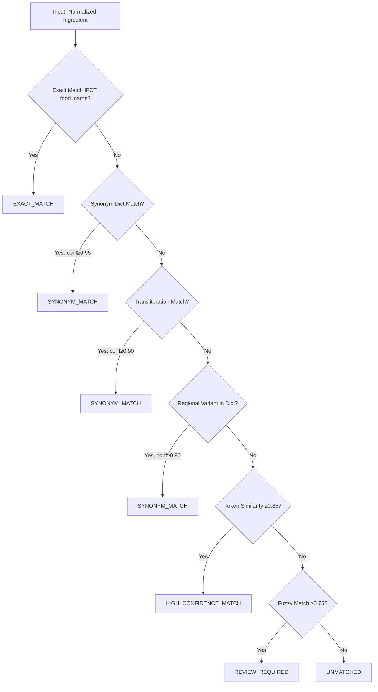
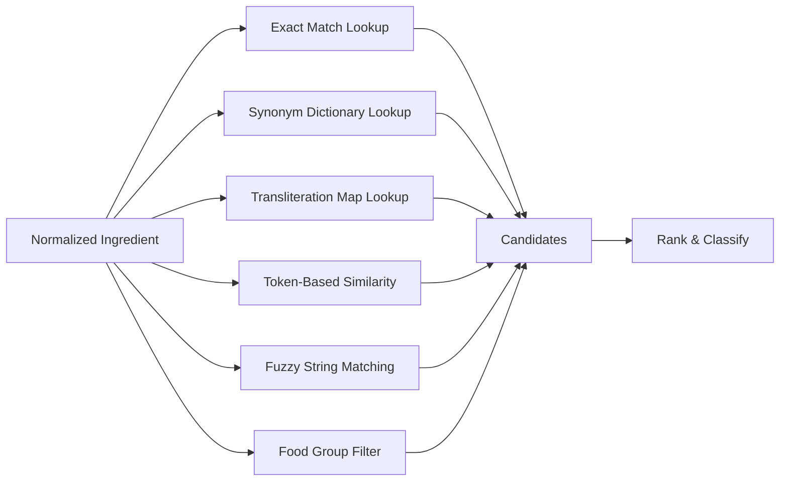
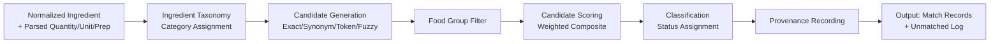

# Phase 3 Stage 1: IFCT Ingredient Matching Architecture

**Date:** 2026-11-17  
**Status:** Design Document — For Review  
**Phase:** 3 — Stage 1 (Architecture & Taxonomy Design)  
**Prerequisites:** Phase 1 & 2 Complete (80/80 tests passing)

---

## 1. Input Data Inspection Summary

### 1.1 Phase 2 Canonical Ingredients (`data/interim/phase2/parsed_recipe_ingredients.parquet`)

| Metric | Value |
|--------|-------|
| Total canonical records | 90,862 |
| Unique recipes | 6,865 |
| Unique normalized ingredients | 26,210 |
| Source reconciliation | canonical: 75,211 (82.8%), raw_only: 7,887, en_only: 7,764 |
| Discrepancies | 0 |
| Parse status distribution | PARSED_EXACT: 54,903 (60.4%), PARSED_APPROXIMATE: 29,980 (33.0%), UNQUANTIFIED: 4,306 (4.7%), RANGE_PARSED: 1,673 (1.8%) |
| Conversion status | UNRESOLVED: 89,525, RESOLVED_HOUSEHOLD: 1,337 |
| Gram weight resolved | 1,299 records |
| Source field distribution | ingredients_raw: 83,098, ingredients_en: 7,764 |

### 1.2 IFCT 2017 Table 1 Candidate Dataset

| Metric | Value |
|--------|-------|
| Records | 528 |
| Unique food codes | 528 |
| Food groups | 18 |
| Nutrient columns | moisture_g, protein_g, ash_g, fat_g, fibre_total_g, fibre_insoluble_g, fibre_soluble_g, carb_available_g, energy_kj |
| All values per 100g edible portion (raw) | ✅ Verified from IFCT 2017 PDF |

### 1.3 Ingredient Synonym Dictionary

| Metric | Value |
|--------|-------|
| Total entries | 264 |
| Categories | spice (59), vegetable_other (32), pulse (28), grain (26), vegetable_root_tuber (24), fruit (22), vegetable_leafy (17), dairy (14), nut (14), oil (10), sweetener (7), dried_fruit (6), fat (5) |

### 1.4 Household Measurements

| Metric | Value |
|--------|-------|
| Total entries | 68 |
| Units | cup, tablespoon, teaspoon, piece, clove |
| Conversion factors | cup=236.588ml, tbsp=14.7868ml, tsp=4.92892ml, clove=1g |

---

## 2. Ingredient Taxonomy Design

### 2.1 Taxonomy Categories

The ingredient taxonomy organizes all possible ingredient identities into mutually exclusive categories that determine matching eligibility.

```mermaid
graph TD
    A[Ingredient Taxonomy] --> B[Exact Identity]
    A --> C[Verified Synonym]
    A --> D[Hindi-English Transliteration]
    A --> E[Regional Name Variant]
    E1[Exact species match]
    E2[Regional variety]
    A --> F[Ingredient Variety]
    F1[Cultivar/variety difference]
    F2[Same species, different cultivar]
    A --> G[Species Distinction]
    G1[Different species, same genus]
    G2[Different genus]
    A --> H[Preparation State]
    H1[Fresh vs Dried]
    H2[Raw vs Cooked]
    H3[Whole vs Processed]
    A --> I[Edible Part]
    I1[Whole vs Edible Part]
    I2[With/Without Skin/Seed]
    A --> J[Composite Ingredient]
    J1[Multi-component]
    J2[Prepared Mixture]
    A --> K[Ambiguous Description]
    K1[Generic/Ambiguous Name]
    K2[Brand/Trade Name]
    A --> L[Absent from IFCT]
    L1[No candidate in IFCT]
```



### 2.2 Category Definitions & Matching Eligibility

| Category | Definition | Matching Eligibility | Examples |
|----------|------------|----------------------|----------|
| **Exact Identity** | Normalized string exactly matches IFCT `food_name` | **EXACT_MATCH** — Auto-accept | "onion (bulb)" ↔ IFCT "onion (bulb)" |
| **Verified Synonym** | Entry in synonym dictionary with confidence ≥0.95 | **SYNONYM_MATCH** — Auto-accept | "toor dal" → "pigeon pea" |
| **Hindi-English Transliteration** | Devanagari or transliterated Hindi name in synonym dict | **SYNONYM_MATCH** — Auto-accept | "हल्दी" → "turmeric", "हल्दी" → "turmeric" |
| **Regional Name Variant** | Regional Indian name in synonym dict | **SYNONYM_MATCH** — Auto-accept | "arhar dal" → "pigeon pea" |
| **Ingredient Variety** | Same species, different cultivar/variety | **HIGH_CONFIDENCE_MATCH** — Review required | "basmati rice" vs "sona masuri rice" |
| **Species Distinction** | Different species (same/different genus) | **REVIEW_REQUIRED** — Manual review | "bengal gram" vs "chickpea" (same species) |
| **Preparation State** | Fresh/dried, raw/cooked, whole/processed | **PREP_STATE_MISMATCH** → Review | "fresh coconut" vs "dried coconut" |
| **Edible Part** | Whole vs specific edible part | **REVIEW_REQUIRED** | "coconut water" vs "coconut kernel" |
| **Composite Ingredient** | Multi-component or prepared mixture | **COMPOSITE** → Decompose or REVIEW_REQUIRED | "ginger garlic paste", "garam masala" |
| **Ambiguous Description** | Generic/ambiguous name, brand name | **AMBIGUOUS** → Human review | "curry powder", "masala" |
| **Absent from IFCT** | No candidate in IFCT 528 foods | **UNMATCHED** | "quinoa", "chia seeds", "kale" |

### 2.3 Category Decision Matrix

| Category | Auto-Accept | Requires Review | Evidence Required |
|----------|-------------|-----------------|-------------------|
| Exact Identity | ✅ | ❌ | String equality on normalized name |
| Verified Synonym | ✅ (conf ≥ 0.95) | ❌ | Synonym dict entry |
| Hindi Transliteration | ✅ (conf ≥ 0.90) | ❌ | Synonym dict entry |
| Regional Variant | ✅ (conf ≥ 0.90) | ❌ | Synonym dict entry |
| Ingredient Variety | ❌ | ✅ | Variety name + species match |
| Species Distinction | ❌ | ✅ | Scientific name verification |
| Prep State Difference | ❌ | ✅ | Prep descriptor analysis |
| Edible Part Difference | ❌ | ✅ | Part specification in name |
| Composite Ingredient | ❌ | ✅ | Component decomposition |
| Ambiguous Description | ❌ | ✅ | Human disambiguation |
| Absent from IFCT | ❌ | N/A | No candidate |

---

## 3. Matching Hierarchy

### 3.1 Hierarchy Definition



### 3.2 Hierarchy Levels (Priority Order)

| Priority | Level | Status | Auto-Accept | Review Required |
|----------|-------|--------|-------------|-----------------|
| 1 | EXACT_MATCH | Auto-accept | ✅ | No |
| 2 | SYNONYM_MATCH (verified) | Auto-accept | ✅ | No |
| 3 | TRANSLITERATION_MATCH | Auto-accept | ✅ | No |
| 4 | REGIONAL_VARIANT | Auto-accept | ✅ | No |
| 5 | HIGH_CONFIDENCE_MATCH | Review required | ❌ | Yes |
| 6 | PREP_STATE_COMPATIBLE | Review required | ❌ | Yes |
| 6 | EDIBLE_PART_COMPATIBLE | Review required | ❌ | Yes |
| 7 | VARIETY_MATCH | Review required | ❌ | Yes |
| 8 | SPECIES_MATCH | Review required | ❌ | Yes |
| 9 | COMPOSITE_DECOMPOSED | Review required | ❌ | Yes |
| 9 | REVIEW_REQUIRED | Human review | ❌ | Yes |
| 10 | AMBIGUOUS_MATCH | Human review | ❌ | Yes |
| 11 | UNMATCHED | No candidate | N/A | N/A |

**Key Principle:** String similarity alone never establishes food identity. Every match above HIGH_CONFIDENCE_MATCH requires explicit evidence (synonym dict, transliteration table, scientific name verification).

---

## 4. Candidate Generation Design

### 4.1 Candidate Generation Pipeline



### 4.2 Candidate Generation Methods

| Method | Implementation | Trigger | Output |
|--------|----------------|---------|--------|
| **Exact Match** | Hash lookup on normalized IFCT `food_name` | Always first | 0 or 1 candidate |
| **Synonym Dictionary** | Lookup in `ingredient_synonyms.csv` (264 entries) | Always | 0-N candidates with confidence |
| **Transliteration Map** | Devanagari→Latin + common transliterations map | On Devanagari input | 0-N candidates |
| **Token Jaccard** | Jaccard similarity on normalized tokens | Always (fallback) | Top-K by Jaccard |
| **Character n-gram** | 3-gram overlap (TF-IDF weighted) | Fallback | Top-K by cosine similarity |
| **Food Group Filter** | Filter candidates by compatible IFCT food group | Always (post-filter) | Filtered candidate set |

### 4.3 Candidate Scoring

Each candidate receives a composite score:

```
score = w1 * exact_match + w2 * synonym_conf + w3 * token_similarity + w4 * food_group_compat + w5 * prep_state_compat
```

| Component | Weight | Description |
|-----------|--------|-------------|
| exact_match | 1.0 | Binary: exact normalized string match |
| synonym_conf | 0.95 | Synonym dictionary confidence |
| token_similarity | 0.70 | Jaccard on normalized tokens |
| food_group_compat | 0.15 | 1.0 if same IFCT food group, 0.5 if related, 0 otherwise |
| prep_state_compat | 0.10 | 1.0 if compatible prep states, 0.5 if unknown, 0 if incompatible |

**Note:** Weights are initial values; calibration requires manual gold-standard evaluation (Stage 4).

---

## 5. Matching Classification System

### 6.1 Status Definitions

| Status | Definition | Action |
|--------|------------|--------|
| `EXACT_MATCH` | Normalized string == IFCT `food_name` | Auto-accept, log provenance |
| `SYNONYM_MATCH` | Verified synonym dict entry (conf ≥ 0.95) | Auto-accept |
| `TRANSLITERATION_MATCH` | Devanagari/transliteration match (conf ≥ 0.90) | Auto-accept |
| `REGIONAL_VARIANT` | Auto-accept | Regional name in synonym dict (conf ≥ 0.90) |
| `HIGH_CONFIDENCE_MATCH` | Token similarity ≥ 0.85, same food group, compatible prep | Flag for review |
| `PREP_STATE_COMPATIBLE` | Prep state compatible (e.g., fresh ↔ raw) | Flag for review |
| `EDIBLE_PART_COMPATIBLE` | Edible part compatible | Flag for review |
| `VARIETY_MATCH` | Same species, different cultivar | Flag for review |
| `SPECIES_MATCH` | Same species, different variety/prep | Flag for review |
| `PREP_STATE_COMPATIBLE` | Prep state compatible | Flag for review |
| `EDIBLE_PART_COMPATIBLE` | Edible part compatible | Flag for review |
| `REVIEW_REQUIRED` | Score ≥ 0.70 but < auto-accept threshold | Human review |
| `AMBIGUOUS_MATCH` | Multiple candidates with similar scores | Human review |
| `UNMATCHED` | No candidate ≥ 0.50 | Log, no match |

### 5.2 Confidence Policy

| Confidence Level | Condition | Action |
|------------------|-----------|--------|
| **HIGH** (Auto-accept) | EXACT_MATCH, SYNONYM_MATCH (conf≥0.95), TRANSLITERATION_MATCH (conf≥0.90), REGIONAL_VARIANT (conf≥0.90) | Auto-accept, log provenance |
| **MEDIUM** (Review) | Score 0.70–0.84, or HIGH_CONFIDENCE_MATCH, PREP_STATE_COMPATIBLE, EDIBLE_PART_COMPATIBLE, VARIETY_MATCH, SPECIES_MATCH | Flag for human review |
| **LOW** | Score 0.50–0.69, AMBIGUOUS_MATCH | Flag for review, log alternatives |
| **UNMATCHED** | No candidate ≥ 0.50 | Log, no match |

**Threshold Calibration:** Thresholds are initial values. Final calibration requires manual gold-standard evaluation (Stage 4) with ≥200 manually verified matches.

**Critical Rule:** A similarity score is **never** presented as a probability of correctness unless calibrated and validated against independent ground truth.

---

## 6. Matching Architecture

### 7.1 Module Structure

```
src/
├── matching/
│   ├── __init__.py
│   ├── ingredient_taxonomy.py       # Taxonomy categories, category assignment
│   ├── candidate_generator.py       # Candidate generation pipeline
│   ├── matching_rules.py            # Matching rules, hierarchy, classification
│   ├── matching_confidence.py       # Scoring, confidence calibration, thresholds
│   ├── candidate_generator.py       # Candidate generation pipeline
│   ├── matcher.py                   # Main orchestrator
│   └── provenance.py                # Match provenance tracking
├── nutrition/
│   ├── __init__.py
│   ├── nutrient_calculator.py
│   ├── edible_portion.py
│   ├── nutrient_validation.py
└── __init__.py
```

### 7.2 Module Responsibilities

| Module | Responsibility |
|--------|----------------|
| `ingredient_taxonomy.py` | Taxonomy categories, category assignment, category decision matrix |
| `candidate_generator.py` | Exact match, synonym dict, transliteration, token similarity, fuzzy, food group filter |
| `matching_rules.py` | Hierarchy, classification logic, status definitions, evidence requirements |
| `matching_confidence.py` | Scoring weights, threshold calibration, confidence calibration |
| `candidate_generator.py` | Orchestrates candidate generation pipeline |
| `matcher.py` | Main orchestrator: input → candidates → rank → classify → output |
| `provenance.py` | Match provenance tracking (input → candidates → selection → decision) |

### 7.3 Data Flow



---

## 8. Proposed Schemas

### 8.1 Ingredient Matching Input (`IngredientMatchInput`)

| Field | Type | Nullable | Description |
|-------|------|----------|-------------|
| `recipe_id` | int64 | NO | FK to recipes |
| `ingredient_record_id` | string | NO | Unique ID from Phase 2 canonical |
| `original_ingredient` | string | NO | Original text from recipe |
| `normalized_ingredient` | string | NO | Phase 2 normalized text |
| `source_field` | enum[raw, en] | NO | Source: ingredients_raw / ingredients_en |
| `source_reconciliation` | enum | NO | canonical/raw_only/en_only |
| `quantity` | struct | YES | Parsed quantity (value, min, max, is_range, original_text) |
| `unit` | struct | YES | Parsed unit (unit, standardized_unit, category, conversion_factor, is_approximate, original_text) |
| `ingredient_name` | string | YES | Parsed ingredient name (without quantity/unit) |
| `preparation` | string | YES | Preparation descriptor (chopped, sliced, etc.) |
| `size_descriptor` | string | YES | Size qualifier (small, medium, large) |
| `parse_status` | enum | NO | PARSED_EXACT, PARSED_APPROXIMATE, RANGE_PARSED, UNQUANTIFIED |
| `conversion_status` | enum | NO | UNRESOLVED, RESOLVED_HOUSEHOLD |
| `gram_weight` | float | YES | Resolved gram weight (if any) |
| `gram_weight_min` | float | YES | For ranges |
| `gram_weight_max` | float | YES | For ranges |
| `source_reconciliation` | enum | NO | canonical/raw_only/en_only |
| `source_field` | enum | NO | ingredients_raw / ingredients_en |

### 8.2 Candidate Record (`MatchCandidate`)

| Field | Type | Nullable | Description |
|-------|------|----------|-------------|
| `candidate_id` | string | NO | UUID |
| `input_record_id` | string | NO | FK to ingredient record |
| `ifct_food_code` | string | NO | IFCT food_code |
| `ifct_food_name` | string | NO | IFCT food_name |
| `ifct_food_group` | string | NO | IFCT food_group |
| `match_method` | enum | NO | EXACT, SYNONYM, TRANSLITERATION, REGIONAL, TOKEN_SIM, FUZZY |
| `similarity_score` | float | NO | 0.0–1.0 composite score |
| `evidence` | json | NO | Evidence details (synonym key, token overlap, etc.) |
| `food_group_compat` | float | NO | 0.0, 0.5, 1.0 |
| `prep_state_compat` | float | NO | 0.0, 0.5, 1.0 |
| `evidence_details` | json | YES | Method-specific evidence |

### 8.3 Accepted Mapping (`IngredientMatch`)

| Field | Type | Nullable | Description |
|-------|------|----------|-------------|
| `match_id` | string | NO | UUID |
| `input_record_id` | string | NO | FK to input |
| `ifct_food_code` | string | NO | Matched IFCT food_code |
| `ifct_food_name` | string | NO | Matched IFCT food_name |
| `ifct_food_group` | string | NO | Matched IFCT food_group |
| `match_status` | enum | NO | EXACT_MATCH, SYNONYM_MATCH, TRANSLITERATION_MATCH, REGIONAL_VARIANT, HIGH_CONFIDENCE_MATCH, PREP_STATE_COMPATIBLE, EDIBLE_PART_COMPATIBLE, VARIETY_MATCH, SPECIES_MATCH, REVIEW_REQUIRED, AMBIGUOUS_MATCH, UNMATCHED |
| `match_method` | enum | NO | EXACT, SYNONYM, TRANSLITERATION, REGIONAL, TOKEN_SIM, FUZZY |
| `similarity_score` | float | NO | 0.0–1.0 |
| `confidence_level` | enum | NO | HIGH, MEDIUM, LOW, UNMATCHED |
| `evidence` | json | NO | Supporting evidence |
| `gram_weight` | float | YES | Resolved gram weight (if available) |
| `gram_weight_min` | float | YES | For ranges |
| `gram_weight_max` | float | YES | For ranges |
| `conversion_status` | enum | NO | UNRESOLVED, RESOLVED_HOUSEHOLD |
| `provenance` | json | NO | Full provenance trail |
| `review_status` | enum | NO | PENDING, APPROVED, REJECTED |
| `reviewer_notes` | string | YES | Human reviewer notes |
| `created_at` | datetime | NO | Timestamp |

### 8.4 Rejected Mapping (`RejectedMatch`)

| Field | Type | Description |
|-------|------|-------------|
| `rejection_id` | UUID | Unique ID |
| `input_record_id` | string | FK to input |
| `rejected_ifct_code` | string | Rejected IFCT food_code |
| `rejected_ifct_name` | string | Rejected IFCT food_name |
| `rejection_reason` | enum | FOOD_IDENTITY_MISMATCH, PREP_STATE_INCOMPATIBLE, EDIBLE_PART_MISMATCH, SPECIES_MISMATCH, VARIETY_MISMATCH, AMBIGUOUS, LOW_CONFIDENCE |
| `rejected_candidate_score` | float | Score of rejected candidate |
| `rejection_notes` | string | Human-readable reason |

### 8.5 Manual Review Record (`ManualReviewRecord`)

| Field | Type | Description |
|-------|------|-------------|
| `review_id` | UUID | Unique ID |
| `input_record_id` | string | FK to input |
| `candidate_ifct_codes` | array[string] | Candidate IFCT codes |
| `candidate_scores` | array[float] | Candidate scores |
| `reviewer_decision` | enum | ACCEPT, REJECT, DEFER, SPLIT |
| `selected_ifct_code` | string | Selected IFCT code (if ACCEPT) |
| `reviewer_notes` | string | Free text |
| `review_timestamp` | datetime | Timestamp |

### 8.6 Match Provenance (`MatchProvenance`)

| Field | Type | Description |
|-------|------|-------------|
| `provenance_id` | UUID | Unique ID |
| `match_id` | string | FK to IngredientMatch |
| `input_text` | string | Original ingredient text |
| `normalized_text` | string | Normalized ingredient text |
| `candidates_considered` | int | Number of candidates generated |
| `candidates_rejected` | int | Number rejected before selection |
| `selection_reason` | string | Reason for final selection |
| `match_method` | enum | Method that produced the match |
| `similarity_breakdown` | json | Score component breakdown |
| `review_trail` | json | Manual review trail (if any) |

### 8.7 Unmatched Ingredient Log (`UnmatchedIngredient`)

| Field | Type | Description |
|-------|------|-------------|
| `unmatched_id` | UUID | Unique ID |
| `input_record_id` | string | FK to input |
| `reason` | enum | NO_CANDIDATE, LOW_CONFIDENCE, AMBIGUOUS, FOOD_ABSENT_FROM_IFCT |
| `top_candidate_ifct_code` | string | Best candidate (if any) |
| `top_candidate_score` | float | Score of best candidate |
| `reason_detail` | string | Detailed reason |

---

## 9. Testing Strategy

### 9.1 Test Categories

| Test Category | Description | Test Cases |
|---------------|-------------|------------|
| **Exact Matching** | Exact string match to IFCT food_name | 10 cases |
| **Synonym Matching** | Verified synonym dictionary matches | 20 cases |
| **Transliteration** | Devanagari/transliterated Hindi | 15 cases |
| **Regional Variants** | Regional name variants | 10 cases |
| **Fresh vs Dried** | Fresh vs dried distinction | 10 cases |
| **Raw vs Cooked** | Raw vs cooked distinction | 10 cases |
| **Whole vs Split** | Whole vs split/dehulled pulses | 8 cases |
| **Different Species** | Similar names, different species | 10 cases |
| **Different Varieties** | Same species, different cultivar | 8 cases |
| **Composite Ingredients** | Multi-component ingredients | 10 cases |
| **Ambiguous Names** | Generic/ambiguous names | 10 cases |
| **Missing from IFCT** | Ingredients absent from IFCT | 10 cases |
| **Fresh vs Dried** | Fresh vs dried distinction | 10 cases |
| **Raw vs Cooked** | Raw vs cooked distinction | 10 cases |
| **Whole vs Split** | Whole vs split/dehulled | 8 cases |
| **Preparation State** | Prep descriptors (chopped, sliced, etc.) | 10 cases |
| **Composite Ingredients** | Pastes, masalas, pastes | 10 cases |
| **Ambiguous Names** | Generic/ambiguous names | 10 cases |
| **Missing from IFCT** | Known absent ingredients | 10 cases |

### 10.1 Test Infrastructure

```python
# tests/phase3/test_matching.py
import pytest
from src.matching.matcher import IngredientMatcher
from src.matching.ingredient_taxonomy import IngredientTaxonomy

@pytest.fixture
def matcher():
    return IngredientMatcher()

@pytest.fixture
def ifct_data():
    return pd.read_parquet('data/interim/ifct_final_candidate/ifct_table1_candidate.parquet')

# Exact match tests
def test_exact_match(matcher, ifct_data):
    result = matcher.match("onion (bulb)")
    assert result.match_status == "EXACT_MATCH"
    assert result.ifct_food_code == "..."  # IFCT code for onion (bulb)

# Synonym tests
def test_synonym_match(matcher):
    result = matcher.match("toor dal")
    assert result.match_status == "SYNONYM_MATCH"
    assert result.ifct_food_code == "..."  # pigeon pea

# Fresh vs dried
def test_fresh_vs_dried(matcher):
    fresh = matcher.match("fresh coconut")
    dried = matcher.match("dried coconut")
    assert fresh.ifct_food_code != dried.ifct_food_code
    assert fresh.match_status != dried.match_status

# Raw vs cooked
def test_raw_vs_cooked(matcher):
    raw = matcher.match("raw onion")
    cooked = matcher.match("cooked onion")
    assert raw.ifct_food_code != cooked.ifct_food_code

# Composite ingredient
def test_composite(matcher):
    result = matcher.match("ginger garlic paste")
    assert result.match_status in ["COMPOSITE_DECOMPOSED", "REVIEW_REQUIRED"]

# Ambiguous name
def test_ambiguous(matcher):
    result = matcher.match("curry powder")
    assert result.match_status == "AMBIGUOUS_MATCH"

# Missing from IFCT
def test_missing_ifct(matcher):
    result = matcher.match("chia seeds")
    assert result.match_status == "UNMATCHED"
```

### Test Execution

```bash
# Run Phase 3 tests
py -m pytest tests/phase3/ -v

# Run with coverage
py -m pytest tests/phase3/ --cov=src/matching --cov-report=term-missing
```

---

## 10. Implementation Sequence

| Stage | Task | Dependencies | Deliverable |
|-------|------|--------------|-------------|
| **1** | IFCT Schema Validation | IFCT data loaded | Schema validation report |
| 2 | Ingredient Taxonomy | IFCT food groups, synonym dict | `ingredient_taxonomy.py` |
| 3 | Candidate Generation | Taxonomy, IFCT data | `candidate_generator.py` |
| 4 | Matching Rules & Hierarchy | Taxonomy, Candidate Gen | `matching_rules.py` |
| 4 | Matching Confidence | Matching Rules | `matching_confidence.py` |
| 5 | Candidate Generator | Candidate Gen, Matching Rules | `candidate_generator.py` |
| 6 | Matcher Orchestrator | All matching modules | `matcher.py` |
| 7 | Provenance Tracking | Matcher | `provenance.py` |
| 5 | Manual Gold Standard | Test Cases | `gold_standard.csv` |
| 7 | Matching Evaluation | Gold Standard | Evaluation report |
| 8 | Integration & Validation | All | Stage 1 report |

---

## 11. Unresolved Design Questions

| Question | Status | Notes |
|----------|--------|-------|
| Confidence threshold calibration | Open | Requires gold standard (Stage 4) |
| Weight calibration for scoring components | Open | Requires gold standard |
| Hindi transliteration coverage | Partial | Current dict covers ~200 terms |
| Composite ingredient decomposition | Open | Requires recipe context |
| Cooking retention factors | Not in scope | Document as limitation |
| Oil absorption estimation | Not in scope | Document as limitation |
| Edible portion from IFCT | Partial | IFCT has no edible portion column in Table 1 |

---

## 12. Acceptance Criteria for Stage 1

| Criterion | Target | Verification |
|-----------|--------|--------------|
| Architecture document complete | ✅ | `stage1_matching_architecture.md` |
| Taxonomy document complete | ✅ | `stage1_matching_taxonomy.md` |
| Confidence policy documented | ✅ | `stage1_confidence_policy.md` |
| All schemas defined | ✅ | In architecture doc |
| Test strategy defined | ✅ | Test plan in architecture doc |
| Architecture review | Pending | Review by tech lead |
| Phase 1/2 inputs unchanged | ✅ | Hash verification |

---

## Unresolved Design Questions

| Question | Impact | Resolution Approach |
|----------|--------|---------------------|
| Confidence threshold calibration | High | Requires gold standard (Stage 4) |
| Hindi transliteration coverage | Medium | Expand synonym dict iteratively |
| Composite ingredient decomposition | High | Recipe context needed |
| Cooking retention factors | Not in scope | Document as limitation |
| Edible portion from IFCT | Partial | IFCT Table 1 has no edible portion column |
| Oil absorption model | Out of scope | Document limitation |

---

## Sign-off

| Role | Name | Date | Signature |
|------|------|------|-----------|
| Architecture Designer | — | 2026-11-17 | — |
| Technical Review | — | — | Pending |
| QA Review | — | — | Pending |

---

**Status:** ✅ **Stage 1 Design Complete — Ready for Review**  
**Next Step:** Architecture Review → Stage 2 Implementation (Candidate Generation)