# Phase 3 Stage 1: Ingredient Matching Taxonomy

**Date:** 2026-11-17  
**Phase:** 3 — Stage 1  
**Status:** Design Document

---

## 1. Overview

This document defines the complete ingredient taxonomy used for matching normalized recipe ingredients to IFCT 2017 Table 1 food records. The taxonomy categorizes every possible ingredient relationship and determines matching eligibility, evidence requirements, and auto-acceptance rules.

---

## 1. Taxonomy Overview

```mermaid
graph TD
    ROOT[Ingredient Match Taxonomy]
    
    ROOT --> EXACT[1. EXACT_IDENTITY]
    ROOT --> SYN[2. VERIFIED_SYNONYM]
    ROOT --> TRANS[3. TRANSLITERATION]
    ROOT --> REG[4. REGIONAL_VARIANT]
    ROOT --> VAR[5. INGREDIENT_VARIETY]
    ROOT --> SPEC[6. SPECIES_DISTINCTION]
    ROOT --> PREP[7. PREPARATION_STATE]
    ROOT --> PART[8. EDIBLE_PART]
    ROOT --> COMP[9. COMPOSITE_INGREDIENT]
    ROOT --> AMB[10. AMBIGUOUS]
    ROOT --> ABSENT[11. ABSENT_FROM_IFCT]
    
    style EXACT fill:#c8e6c9
    style SYN fill:#c8e6c9
    style TRANS fill:#c8e6c9
    style REG fill:#c8e6c9
    style VAR fill:#fff9c4
    style SPEC fill:#fff9c4
    style PREP fill:#fff9c4
    style PART fill:#fff9c4
    style COMP fill:#ffcdd2
    style AMB fill:#ffcdd2
    style ABSENT fill:#ffcdd2
```



---

## 2. Category Definitions

### 1. EXACT_IDENTITY (Auto-Accept)

| Property | Specification |
|--------|--------------|
| **Definition** | Normalized ingredient string exactly equals IFCT `food_name` (case-insensitive, whitespace-normalized) |
| **Match Status** | `EXACT_MATCH` |
| **Auto-Accept** | ✅ Yes |
| **Evidence Required** | Exact string equality on normalized `food_name` |
| **Confidence** | 1.0 (deterministic) |
| **Provenance** | `match_method: EXACT`, `similarity_score: 1.0` |

**Examples:**
- Input: `"onion (bulb)"` → IFCT `"onion (bulb)"` ✅
- Input: `"cumin seeds"` → IFCT `"cumin seeds"` ✅
- Input: `"turmeric powder"` → IFCT `"turmeric powder"` ✅

**Edge Cases:**
- Case/whitespace normalization applied before comparison
- Parenthetical qualifiers must match exactly: `"onion (bulb)"` ≠ `"onion"`

---

### 2. VERIFIED_SYNONYM (Auto-Accept)

| Property | Specification |
|--------|--------------|
| **Definition** | Normalized ingredient matches a verified entry in `ingredient_synonyms.csv` with confidence ≥ 0.95 |
| **Match Status** | `SYNONYM_MATCH` |
| **Auto-Accept** | ✅ Yes |
| **Evidence Required** | Synonym dictionary entry with `confidence ≥ 0.95` |
| **Matching Logic** | Exact match on `synonym` field (case-insensitive, whitespace-normalized) |

**Synonym Dictionary Structure:**
```csv
canonical_name,synonym,category,evidence,confidence,excludes
pigeon pea,toor dal,pulse,Common Indian name for Cajanus cajan,0.99,"toor dal (split); toor dal (whole)"
pigeon pea,arhar dal,pulse,Hindi name for Cajanus cajan,0.99,"arhar dal (split); arhar dal (whole)"
cumin seeds,jeera,spice,Hindi name,0.99,cumin powder
```

**Confidence Calibration:**
- `confidence ≥ 0.95` → Auto-accept (`SYNONYM_MATCH`)
- `0.85 ≤ confidence < 0.95` → `HIGH_CONFIDENCE_MATCH` (review required)
- `confidence < 0.85` → Not used for auto-matching

**Examples:**
| Input | Synonym Key | Canonical IFCT | Confidence | Status |
|-------|-------------|----------------|------------|--------|
| `toor dal` | `toor dal` | pigeon pea | 0.99 | SYNONYM_MATCH ✅ |
| `arhar dal` | `arhar dal` | pigeon pea | 0.99 | SYNONYM_MATCH ✅ |
| `tuvar dal` | `tuvar dal` | pigeon pea | 0.95 | SYNONYM_MATCH ✅ |
| `red gram` | `red gram` | pigeon pea | 0.95 | SYNONYM_MATCH ✅ |
| `jeera` | `jeera` | cumin seeds | 0.99 | SYNONYM_MATCH ✅ |
| `haldi` | `haldi` | turmeric powder | 0.99 | SYNONYM_MATCH ✅ |

**Exclusions (from `excludes` column):**
- `toor dal` excludes `toor dal (split)`, `toor dal (whole)` — these are preparation variants
- `methi` (ambiguous) excludes `methi leaves`, `methi seeds` — must be disambiguated

---

### 3. TRANSLITERATION (Auto-Accept)

| Property | Specification |
|--------|--------------|
| **Definition** | Devanagari script or common transliteration variants matching synonym dictionary entries |
| **Match Status** | `TRANSLITERATION_MATCH` |
| **Auto-Accept** | ✅ Yes (confidence ≥ 0.90) |
| **Evidence Required** | Match in transliteration map or synonym dict with Devanagari key |

**Transliteration Map (Partial):**

| Devanagari | Transliteration | Canonical | Category | Confidence |
|------------|-----------------|-----------|----------|------------|
| हल्दी | haldi | turmeric powder | spice | 0.99 |
| जीरा | jeera | cumin seeds | spice | 0.99 |
| धनिया | dhania | coriander seeds | spice | 0.99 |
| हींग | hing | asafoetida | spice | 0.95 |
| काली मिर्च | kali mirch | black pepper | spice | 0.95 |
| लाल मिर्च | lal mirch | red chili powder | spice | 0.95 |
| हरी मिर्च | hari mirch | green chili | vegetable_other | 0.95 |
| अदरक | adrak | ginger | vegetable_root_tuber | 0.95 |
| लहसुन | lehsun | garlic | vegetable_root_tuber | 0.95 |
| प्याज | pyaz | onion (bulb) | vegetable_root_tuber | 0.95 |
| टमाटर | tamatar | tomato | vegetable_other | 0.95 |
| नमक | namak | salt | sweetener | 0.99 |
| चीनी | chini | sugar (white) | sweetener | 0.99 |
| गुड़ | gud | jaggery | sweetener | 0.95 |
| घी | ghee | ghee | fat | 0.99 |
| तेल | tel | oil (generic) | oil | 0.90 |
| सरसों | sarson | mustard seeds | spice | 0.95 |
| राई | rai | mustard seeds | spice | 0.95 |
| मेथी | methi | fenugreek leaves | vegetable_leafy | 0.85* |
| कसूरी मेथी | kasuri methi | kasuri methi | spice | 0.95 |
| कड़ी पत्ता | curry patta | curry leaves | vegetable_leafy | 0.95 |
| पुदीना | pudina | mint leaves | vegetable_leafy | 0.95 |

* methi (ambiguous) → confidence 0.85, requires disambiguation between leaves/seeds

**Transliteration Rules:**
1. Devanagari → ITRANS/IAST standard transliteration
2. Common variations: `aa/ā`, `ii/ī`, `uu/ū`, `e/ē`, `o/ō`, `ṃ/ṁ`, `ḥ/ḥ`
3. Common variations: `ch/chh`, `ph/ph`, `th/th`, `kh/kh`, `gh/gh`, `ḍ/ḍ`, `ṭ/ṭ`
4. Match against synonym dictionary Devanagari keys first, then transliteration

---

### 4. Regional Name Variant (Auto-Accept)

| Property | Specification |
|--------|--------------|
| **Definition** | Regional Indian name variant present in synonym dictionary with confidence ≥ 0.90 |
| **Match Status** | `REGIONAL_VARIANT` |
| **Auto-Accept** | ✅ Yes (conf ≥ 0.90) |
| **Evidence** | Synonym dictionary entry with regional variant |

**Examples:**

| Regional Name | Region | Canonical | Category | Confidence |
|---------------|--------|-----------|----------|------------|
| `arhar dal` | North India | pigeon pea | pulse | 0.99 |
| `tuvar dal` | Gujarat | pigeon pea | pulse | 0.95 |
| `kandi pappu` | Andhra/Telangana | pigeon pea | pulse | 0.95 |
| `kandi` | South India | pigeon pea | pulse | 0.90 |
| `chana dal` | North India | bengal gram (split) | pulse | 0.99 |
| `kadalai paruppu` | Tamil Nadu | bengal gram (split) | pulse | 0.95 |
| `moong dal` | Pan-India | green gram (split) | pulse | 0.99 |
| `pesara pappu` | Andhra | green gram (split) | pulse | 0.95 |
| `urad dal` | Pan-India | black gram (split) | pulse | 0.99 |
| `minapa pappu` | Telugu | black gram (split) | pulse | 0.95 |
| `masoor dal` | North India | red lentil (split) | pulse | 0.99 |
| `massor dal` | Bengal | red lentil (split) | pulse | 0.95 |
| `rajma` | North India | kidney bean | pulse | 0.99 |
| `chawli` | Maharashtra | cowpea | pulse | 0.95 |
| `lobia` | North India | cowpea | pulse | 0.95 |
| `kala chana` | North India | black chickpea | pulse | 0.99 |
| `kabuli chana` | North India | chickpea (kabuli) | pulse | 0.99 |
| `kala chana` | Punjab | black chickpea | pulse | 0.95 |

**Regional Variant Rules:**
1. Must exist in synonym dictionary with `category` matching target ingredient
2. Confidence ≥ 0.90 for auto-accept
3. `excludes` column checked for preparation/processing exclusions

---

### 5. Ingredient Variety (Review Required)

| Property | Specification |
|--------|--------------|
| **Definition** | Same species, different cultivar/variety with potentially different nutrient profile |
| **Match Status** | `VARIETY_MATCH` |
| **Auto-Accept** | ❌ No — Requires Review |
| **Evidence Required** | Species match + variety name in ingredient text |

**Examples:**

| Input | IFCT Candidate | Species | Variety | Status |
|-------|----------------|---------|---------|--------|
| `basmati rice` | `basmati rice` | Oryza sativa | basmati | VARIETY_MATCH |
| `sona masuri rice` | `rice (raw)` | Oryza sativa | sona masuri | VARIETY_MATCH |
| `brown rice` | `rice (raw)` | Oryza sativa | brown | VARIETY_MATCH |
| `red rice` | `rice (raw)` | Oryza sativa | red | VARIETY_MATCH |
| `basmati rice (cooked)` | `rice (raw)` | Oryza sativa | basmati | PREP_STATE_MISMATCH |
| `brown rice (cooked)` | `rice (raw)` | Oryza sativa | brown | PREP_STATE_MISMATCH |
| `basmati rice (raw)` | `basmati rice` | Oryza sativa | basmati | EXACT_MATCH |

**Rules:**
1. Same species (scientific name match) → `VARIETY_MATCH`
2. Different species → `SPECIES_MATCH` (see below)
3. Preparation state difference → `PREP_STATE_MISMATCH` (higher priority)
4. Nutrient values may differ significantly between varieties → review required

---

### 6. Species Distinction (Review Required)

| Property | Specification |
|--------|--------------|
| **Definition** | Different species (same or different genus) with potentially different nutrient profiles |
| **Match Status** | `SPECIES_MATCH` |
| **Auto-Accept** | ❌ No — Requires Review |
| **Evidence Required** | Scientific name verification |

**Examples:**

| Input | IFCT Candidate | Species Match? | Status |
|-------|----------------|----------------|--------|
| `bengal gram` | `bengal gram (split)` | Same species (Cicer arietinum) | VARIETY_MATCH |
| `chickpea` | `chickpea (kabuli)` | Same species (Cicer arietinum) | VARIETY_MATCH |
| `kala chana` | `chickpea (desi)` | Same species | VARIETY_MATCH |
| `kabuli chana` | `chickpea (kabuli)` | Same species | VARIETY_MATCH |
| `black gram` | `black gram (split)` | Same species (Vigna mungo) | EXACT_MATCH |
| `green gram` | `green gram (split)` | Same species (Vigna radiata) | EXACT_MATCH |
| `cowpea` | `cowpea` | Same species (Vigna unguiculata) | EXACT_MATCH |
| `soya bean` | `soybean` | Same species (Glycine max) | EXACT_MATCH |
| `horse gram` | `horse gram` | Same species (Macrotyloma uniflorum) | EXACT_MATCH |
| `moth bean` | `moth bean` | Same species | EXACT_MATCH |

**Rules:**
1. Same scientific name (genus + species) → `VARIETY_MATCH` (review)
2. Same genus, different species → `SPECIES_MATCH` (review, higher scrutiny)
3. Different genus → `SPECIES_MISMATCH` → `UNMATCHED` or `REVIEW_REQUIRED`
4. Common name ambiguity → manual verification of scientific name required

---

### 7. Preparation State (Review Required)

| Property | Specification |
|--------|--------------|
| **Definition** | Ingredient described with preparation state that may differ from IFCT raw basis |
| **Match Status** | `PREP_STATE_COMPATIBLE` / `PREP_STATE_MISMATCH` |
| **Auto-Accept** | ❌ No — Requires Review |
| **Evidence Required** | Preparation descriptor in ingredient text |

**Preparation State Categories:**

| State | Examples | IFCT Basis | Compatibility |
|-------|----------|------------|---------------|
| **Raw** | "raw onion", "fresh tomato" | IFCT base (raw) | ✅ Compatible |
| **Fresh** | "fresh coriander", "fresh coconut" | IFCT base (raw) | ✅ Compatible |
| **Dried** | "dried coconut", "dried mango" | Not in IFCT (raw basis) | ⚠️ Mismatch |
| **Dried/Powdered** | "turmeric powder", "chili powder" | IFCT has powder forms | ✅ Compatible (if IFCT has powder) |
| **Cooked/Boiled** | "boiled potato", "cooked rice" | IFCT is raw basis | ❌ Mismatch |
| **Roasted/Fried** | "roasted cumin", "fried onion" | IFCT is raw | ❌ Mismatch |
| **Fermented** | "fermented rice", "idli batter" | Not in IFCT | ❌ Mismatch |
| **Soaked** | "soaked chana", "soaked rice" | Not in IFCT | ⚠️ Unknown |
| **Sprouted** | "sprouted moong", "sprouted chana" | Not in IFCT (raw basis) | ⚠️ Mismatch |
| **Pickled** | "pickled mango", "pickled onion" | Not in IFCT | ❌ Mismatch |
| **Canned** | "canned tomatoes" | Not in IFCT | ❌ Mismatch |
| **Frozen** | "frozen peas" | Not in IFCT | ⚠️ Unknown |

**Priority Rules:**
1. Explicit preparation descriptor in ingredient text → determines prep state
2. If no descriptor → assume raw (IFCT default)
2. Cooked/processed ≠ raw → `PREP_STATE_MISMATCH` (review required)
3. Dried/powdered forms → check if IFCT has powder/dried entry
4. Fresh ↔ raw = compatible

---

### 8. Edible Part (Review Required)

| Property | Specification |
|--------|--------------|
| **Definition** | Ingredient specifies specific edible part differing from IFCT default |
| **Match Status** | `EDIBLE_PART_COMPATIBLE` / `EDIBLE_PART_MISMATCH` |
| **Auto-Accept** | ❌ No — Requires Review |
| **Evidence Required** | Explicit edible part descriptor |

**Examples:**

| Input | IFCT Default | Specified Part | Status |
|-------|--------------|----------------|--------|
| `coconut water` | coconut (kernel) | water | EDIBLE_PART_MISMATCH |
| `coconut kernel` | coconut (kernel) | kernel | EDIBLE_PART_COMPATIBLE |
| `coconut milk` | coconut (kernel) | milk | EDIBLE_PART_MISMATCH |
| `coconut oil` | coconut (kernel) | oil | EDIBLE_PART_MISMATCH |
| `orange juice` | orange (fruit) | juice | EDIBLE_PART_MISMATCH |
| `orange peel` | orange (fruit) | peel | EDIBLE_PART_MISMATCH |
| `watermelon seeds` | watermelon (fruit) | seeds | EDIBLE_PART_MISMATCH |
| `pumpkin seeds` | pumpkin (fruit) | seeds | EDIBLE_PART_MISMATCH |
| `apple peel` | apple (fruit) | peel | EDIBLE_PART_MISMATCH |
| `chicken breast` | chicken (meat) | breast | EDIBLE_PART_COMPATIBLE |
| `chicken liver` | chicken (meat) | liver | EDIBLE_PART_COMPATIBLE |
| `mutton liver` | mutton (meat) | liver | EDIBLE_PART_COMPATIBLE |
| `fish fillet` | fish (whole) | fillet | EDIBLE_PART_COMPATIBLE |
| `bone marrow` | bone | marrow | EDIBLE_PART_COMPATIBLE |

**Rules:**
1. IFCT Table 1 generally reports whole food or standard edible portion
2. Specific part ≠ whole food → `EDIBLE_PART_MISMATCH` (review)
2. By-products (oil, milk, juice) → `EDIBLE_PART_MISMATCH`
3. Organ meats → `EDIBLE_PART_COMPATIBLE` (IFCT often has entries)
4. No edible portion data in IFCT Table 1 → flag uncertainty

---

### 9. Composite Ingredient (Decompose or Review)

| Property | Specification |
|--------|--------------|
| **Definition** | Multi-component ingredient or prepared mixture |
| **Match Status** | `COMPOSITE_DECOMPOSED` / `COMPOSITE_REVIEW_REQUIRED` |
| **Auto-Accept** | ❌ No — Requires Review |
| **Action** | Decompose into components OR flag for review |

**Examples:**

| Input | Components | IFCT Candidates | Status |
|-------|------------|-----------------|--------|
| `ginger garlic paste` | ginger + garlic | ginger, garlic | COMPOSITE_DECOMPOSED |
| `onion tomato paste` | onion + tomato | onion, tomato | COMPOSITE_DECOMPOSED |
| `garam masala` | multiple spices | multiple spices | COMPOSITE_REVIEW_REQUIRED |
| `sambar powder` | multiple spices | multiple | COMPOSITE_REVIEW_REQUIRED |
| `curry powder` | multiple spices | multiple | AMBIGUOUS_MATCH |
| `chaat masala` | multiple spices | multiple | COMPOSITE_REVIEW_REQUIRED |
| `pav bhaji masala` | multiple spices | multiple | COMPOSITE_REVIEW_REQUIRED |
| `idli dosa batter` | rice + urad dal | rice, black gram (split) | COMPOSITE_DECOMPOSED |
| `dhokla batter` | rice + chana dal | rice, bengal gram | COMPOSITE_DECOMPOSED |
| `chutney` | varies | varies | COMPOSITE_REVIEW_REQUIRED |
| `pickle` | varies | varies | COMPOSITE_REVIEW_REQUIRED |
| `sauce` | varies | varies | COMPOSITE_REVIEW_REQUIRED |

**Decomposition Rules:**
1. Explicit "paste", "masala", "powder", "batter", "batter" → decompose if components identifiable
2. Generic names ("masala", "curry powder", "chutney") → `COMPOSITE_REVIEW_REQUIRED`
3. If components not identifiable → `AMBIGUOUS_MATCH`
3. Decomposed components each matched independently

---

### 10. Ambiguous Ingredient Description (Human Review)

| Property | Specification |
|--------|--------------|
| **Definition** | Generic/ambiguous name that could map to multiple IFCT entries |
| **Match Status** | `AMBIGUOUS_MATCH` |
| **Auto-Accept** | ❌ No — Human Review Required |
| **Action** | Present top candidates to human reviewer |

**Examples:**

| Input | Possible IFCT Matches | Ambiguity |
|-------|----------------------|-----------|
| `dal` | toor dal, moong dal, chana dal, urad dal, masoor dal, rajma, chana dal, etc. | High |
| `dal` | any pulse | Extreme |
| `rice` | basmati, sona masuri, raw rice, parboiled, brown, red, etc. | High |
| `oil` | mustard, coconut, groundnut, sesame, sunflower, soybean, rice bran, etc. | High |
| `dalia` | broken wheat, broken rice, broken millet | Medium |
| `rava` | semolina (wheat), sooji (semolina) | Medium |
| `atta` | whole wheat flour, chapati atta | Low-Medium |
| `maida` | refined wheat flour | Low |
| `besan` | chickpea flour | Low |
| `suji` | semolina | Low |
| `milk` | cow, buffalo, goat, skim, whole | Medium |
| `curd` | curd, yogurt | Low |
| `ghee` | ghee, clarified butter | Low |
| `butter` | butter, white butter, salted butter | Low |
| `paneer` | paneer, chenna | Low |
| `curry leaves` | curry leaves, bay leaf | Low |
| `coriander` | coriander leaves, coriander seeds | Medium |
| `methi` | fenugreek leaves, fenugreek seeds | High |

**Resolution:**
1. Present top-3 candidates with scores to human reviewer
2. Reviewer selects correct match or marks UNMATCHED
3. Decision logged for future auto-resolution

---

### 11. Absent from IFCT

| Property | Specification |
|--------|--------------|
| **Definition** | No candidate in IFCT 528 foods with similarity ≥ 0.50 |
| **Match Status** | `UNMATCHED` |
| **Auto-Accept** | N/A — No match possible |
| **Action** | Log for future IFCT expansion |

**Known Absent Ingredients (Common in Indian Recipes):**

| Category | Examples |
|----------|----------|
| **Modern/Imported** | quinoa, chia seeds, flax seeds, chia seeds, kale, zucchini, broccoli, asparagus, avocado, blueberry, cranberry, strawberry (fresh), raspberry |
| **Modern Grains** | quinoa, couscous, bulgur, farro, barley (pearled), oats (rolled/instant), cornflakes |
| **Exotic Fruits** | avocado, kiwi, dragon fruit, passion fruit, persimmon, lychee (fresh), rambutan |
| **Exotic Vegetables** | broccoli, zucchini, asparagus, bell pepper (capsicum is present), artichoke, brussels sprouts, kale, romaine lettuce, iceberg lettuce |
| **Processed Foods** | pasta, noodles (instant), bread, pav, bun, pizza base, tortilla, wrap |
| **Condiments/Sauces** | soy sauce, tomato ketchup, mayonnaise, salad dressing, vinegar (balsamic, apple cider), worcestershire sauce, hoisin sauce, oyster sauce, fish sauce |
| **Baking** | baking powder, baking soda, yeast, vanilla extract, cocoa powder (unsweetened), chocolate chips |
| **Dairy (Modern)** | cream cheese, mozzarella, cheddar, processed cheese, greek yogurt, cream |
| **Meat (Processed)** | bacon, ham, salami, sausage, pepperoni, nuggets |
| **Seafood (Modern)** | salmon, tuna (canned), shrimp (frozen), crab sticks |
| **Nuts/Seeds (Modern)** | pumpkin seeds, sunflower seeds, watermelon seeds, pecan, hazelnut, macadamia |
| **Spices (Modern)** | paprika, oregano, thyme, rosemary, basil (dried), parsley (dried), sage |
| **Beverages** | coffee (instant), tea (bag), green tea, herbal tea, soft drinks, packaged juice |
| **Sweeteners** | stevia, artificial sweeteners, maple syrup, honey (raw), jaggery powder |

**Action:** Log all UNMATCHED ingredients with top-3 candidates for future IFCT expansion.

---

## Complete Taxonomy Decision Matrix

| Category | Auto-Accept | Review Required | Evidence Standard | Match Status |
|----------|------------|-----------------|-------------------|--------------|
| EXACT_IDENTITY | ✅ | No | String equality | EXACT_MATCH |
| VERIFIED_SYNONYM (conf≥0.95) | ✅ | No | Synonym dict entry | SYNONYM_MATCH |
| TRANSLITERATION (conf≥0.90) | ✅ | No | Transliteration map | TRANSLITERATION_MATCH |
| REGIONAL_VARIANT (conf≥0.90) | ✅ | No | Synonym dict | REGIONAL_VARIANT |
| INGREDIENT_VARIETY | ❌ | Yes | Species + variety name | VARIETY_MATCH |
| SPECIES_DISTINCTION | ❌ | Yes | Scientific name | SPECIES_MATCH |
| PREPARATION_STATE | ❌ | Yes | Prep descriptor | PREP_STATE_COMPATIBLE/MISMATCH |
| EDIBLE_PART | ❌ | Yes | Part descriptor | EDIBLE_PART_COMPATIBLE/MISMATCH |
| COMPOSITE | ❌ | Yes | Component decomposition | COMPOSITE_DECOMPOSED/REVIEW |
| AMBIGUOUS | ❌ | Yes | Human review | AMBIGUOUS_MATCH |
| ABSENT_FROM_IFCT | N/A | N/A | No candidate ≥0.50 | UNMATCHED |

---

## Appendix: Matching Status Enum

```python
class MatchStatus(Enum):
    # Auto-accept (high confidence)
    EXACT_MATCH = "EXACT_MATCH"
    SYNONYM_MATCH = "SYNONYM_MATCH"
    TRANSLITERATION_MATCH = "TRANSLITERATION_MATCH"
    REGIONAL_VARIANT = "REGIONAL_VARIANT"
    
    # Review required
    HIGH_CONFIDENCE_MATCH = "HIGH_CONFIDENCE_MATCH"
    VARIETY_MATCH = "VARIETY_MATCH"
    SPECIES_MATCH = "SPECIES_MATCH"
    PREP_STATE_COMPATIBLE = "PREP_STATE_COMPATIBLE"
    PREP_STATE_MISMATCH = "PREP_STATE_MISMATCH"
    EDIBLE_PART_COMPATIBLE = "EDIBLE_PART_COMPATIBLE"
    EDIBLE_PART_MISMATCH = "EDIBLE_PART_MISMATCH"
    VARIETY_MATCH = "VARIETY_MATCH"
    SPECIES_MATCH = "SPECIES_MATCH"
    PREP_STATE_COMPATIBLE = "PREP_STATE_COMPATIBLE"
    PREP_STATE_MISMATCH = "PREP_STATE_MISMATCH"
    EDIBLE_PART_COMPATIBLE = "EDIBLE_PART_COMPATIBLE"
    EDIBLE_PART_MISMATCH = "EDIBLE_PART_MISMATCH"
    VARIETY_MATCH = "VARIETY_MATCH"
    SPECIES_MATCH = "SPECIES_MATCH"
    COMPOSITE_DECOMPOSED = "COMPOSITE_DECOMPOSED"
    COMPOSITE_REVIEW_REQUIRED = "COMPOSITE_REVIEW_REQUIRED"
    
    # Human review required
    REVIEW_REQUIRED = "REVIEW_REQUIRED"
    AMBIGUOUS_MATCH = "AMBIGUOUS_MATCH"
    
    # No match
    UNMATCHED = "UNMATCHED"
    NOT_APPLICABLE = "NOT_APPLICABLE"
```

---

## Appendix: Exclusion Rules (from synonym dictionary `excludes` column)

| Synonym | Excludes | Reason |
|---------|----------|--------|
| `toor dal` | `toor dal (split)`, `toor dal (whole)` | Preparation variants |
| `arhar dal` | `arhar dal (split)`, `arhar dal (whole)` | Preparation variants |
| `moong dal` | `moong dal (whole)`, `moong dal (sprouted)` | Preparation variants |
| `urad dal` | `urad dal (whole)`, `urad dal (skinless)` | Processing variants |
| `chana dal` | `chana dal (roasted)` | Processing variant |
| `moong` | `moong dal (split)`, `moong dal (whole)` | Form variants |
| `methi` | `methi leaves`, `methi seeds` | Part ambiguity |
| `methi leaves` | `kasuri methi`, `methi seeds` | Form variants |
| `kasuri methi` | `methi leaves`, `methi seeds` | Form variants |
| `coconut` | `coconut water`, `coconut milk`, `coconut oil` | Different edible parts |
| `coconut water` | `coconut (fresh)`, `coconut milk` | Different products |
| `fresh coconut` | `dried coconut`, `coconut water`, `coconut milk` | Processing variants |
| `dried coconut` | `fresh coconut`, `desiccated coconut` | Processing variants |
| `coconut oil` | `coconut (fresh)`, `coconut water` | Different products |
| `ginger` | `ginger paste`, `dried ginger` | Form variants |
| `garlic` | `garlic paste`, `garlic powder` | Form variants |
| `onion` | `onion (spring)`, `onion (fried)`, `onion powder` | Preparation variants |
| `tomato` | `tomato puree`, `tomato ketchup`, `sun-dried tomato` | Processing variants |
| `chili` | `chili powder`, `red chili flakes`, `green chili paste` | Form variants |
| `turmeric` | `turmeric powder`, `fresh turmeric` | Form variants |
| `cumin` | `cumin powder`, `cumin seeds` | Form variants |
| `coriander` | `coriander powder`, `coriander leaves` | Part variants |
| `methi` | `methi leaves`, `methi seeds`, `kasuri methi` | Ambiguous base term |
| `methi dana` | `methi leaves` | Form variants |
| `kasuri methi` | `methi leaves`, `methi seeds` | Form variants |
| `onion` | `spring onion`, `onion powder`, `fried onion` | Preparation variants |
| `garlic` | `garlic paste`, `garlic powder` | Form variants |
| `ginger` | `ginger paste`, `dried ginger` | Form variants |
| `coconut` | `coconut water`, `coconut milk`, `coconut oil` | Different products |
| `fresh coconut` | `dried coconut`, `coconut water` | Processing variants |
| `dried coconut` | `fresh coconut`, `desiccated coconut` | Processing variants |
| `rice` | `cooked rice`, `rice flour`, `rice flakes`, `puffed rice` | Processing variants |
| `wheat` | `wheat flour (whole)`, `wheat flour (refined)`, `semolina`, `broken wheat` | Processing variants |
| `dal` | `toor dal`, `moong dal`, `chana dal`, `urad dal`, `masoor dal`, `rajma`, `lobia`, `kala chana`, `kabuli chana` | Generic term |
| `oil` | `mustard oil`, `coconut oil`, `groundnut oil`, `sesame oil`, `sunflower oil`, `soybean oil`, `rice bran oil`, `olive oil`, `canola oil` | Generic term |
| `milk` | `milk (buffalo)`, `milk (skim)`, `milk powder`, `condensed milk` | Variants |
| `curd` | `yogurt`, `greek yogurt`, `buttermilk` | Variants |
| `ghee` | `clarified butter`, `vanaspati` | Variants |
| `butter` | `salted butter`, `unsalted butter`, `white butter` | Variants |
| `oil` | `mustard oil`, `coconut oil`, `groundnut oil`, `sunflower oil`, `sesame oil`, `soybean oil`, `rice bran oil` | Generic term |

---

*End of Stage 1 Matching Taxonomy Document*