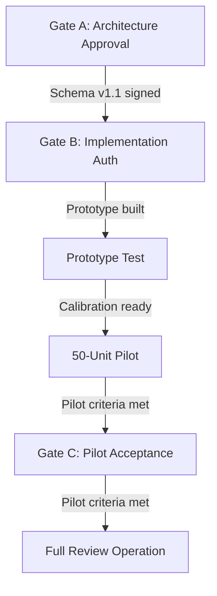

# Stage 3.3.1: Implementation Gate Definitions

**Date:** 2026-11-18  
**Source:** Stage 3.3.1 Approval Reconciliation

---

## Three Approval Gates

### Gate A — Architecture Approval
**Purpose:** Authorize the Stage 3.2.3 architecture as the basis for workbench development.

**Requirements:**
- ✅ Review-unit architecture approved (7,992 units, corrected key)
- ❌ Schema v1.1 formally signed off
- ✅ Priority and sampling definitions approved
- ✅ Evidence requirements approved
- ❌ Remaining limitations documented

**Authorization:** Architecture Review Lead + QA Lead  
**Status:** ❌ NOT MET — Blocker BLK-001 and BLK-007 unresolved

**Authorization Trigger:** Architecture Review Lead + QA Lead sign-off on Schema v1.1

---

### Gate B — Workbench Implementation Authorization
**Purpose:** Authorize workbench prototype development.

**Requirements:**
- ❌ No unresolved critical design or data-integrity blockers
- ❌ Reviewer model selected (≥4 reviewers committed)
- ❌ Minimum viable workflow defined
- ❌ Development scope approved
- ❌ Data protection and audit-history requirements defined

**Authorization:** Project Lead + QA Lead  
**Status:** ❌ NOT MET — 15 blockers unresolved

**Authorization Trigger:** Project Lead + QA Lead sign-off after all CRITICAL/HIGH blockers resolved

---

### Gate C — Pilot Acceptance
**Requirements:**
- ❌ Working prototype exists
- ❌ Calibration materials prepared (5-unit set)
- ❌ 50-unit pilot completed
- ❌ Review decisions and provenance verified
- ❌ Errors and reviewer disagreements documented
- ❌ Pilot acceptance criteria met

**Authorization:** QA Lead + Project Lead  
**Status:** ❌ NOT MET — Prerequisites unmet

---

## Gate Sequence and Dependencies

```
Gate A (Architecture Approval)
    │
    ├── Schema v1.1 approved
    │   └──► Gate B (Workbench Implementation)
    │       │
    │       ├── Prototype Development
    │       │   └──► Prototype Tested
    │       │       └──► Gate C (Pilot Acceptance)
    │       │       │
    │       │       ├── Calibration Materials Ready
    │       │       ├── 50-Unit Pilot Completed
    │       │       ├── Pilot Decisions Verified
    │       │       └── Pilot Acceptance Criteria Met
    │       │
    │       └──► Full Review Operation Authorized
```

---

## Gate Criteria Summary

| Gate | Name | Required For | Status | Unblocking Condition |
|------|------|--------------|--------|----------------------|
| A | Architecture Approval | Workbench development | ❌ BLOCKED | BLK-001, BLK-007 resolved; Schema v1.1 signed |
| B | Implementation Authorization | Prototype development | ❌ BLOCKED | All CRITICAL/HIGH blockers resolved; ≥4 reviewers committed |
| C | Pilot Acceptance | Full review operation | ❌ BLOCKED | Prototype tested; Calibration ready; Pilot completed |

---

## Gate Sequence Enforcement



**No gate can be bypassed.** Each gate requires explicit sign-off from designated authorities.

---

## Gate Sign-Off Authorities

| Gate | Required Signatures | Minimum Quorum |
|------|---------------------|----------------|
| A | Architecture Review Lead + QA Lead | 2/2 |
| B | Project Lead + QA Lead | 2/2 |
| C | QA Lead + Project Lead | 2/2 |

---

## Gate Status Tracking

| Gate | Status | Blockers | Target Date |
|------|--------|----------|-------------|
| Gate A | ❌ BLOCKED | BLK-001, BLK-007 | TBD |
| Gate B | ❌ BLOCKED | 15 blockers | TBD |
| Gate C | ❌ BLOCKED | Gate B unmet | TBD |

**No gate can be bypassed.** Each gate requires explicit sign-off from designated authorities.