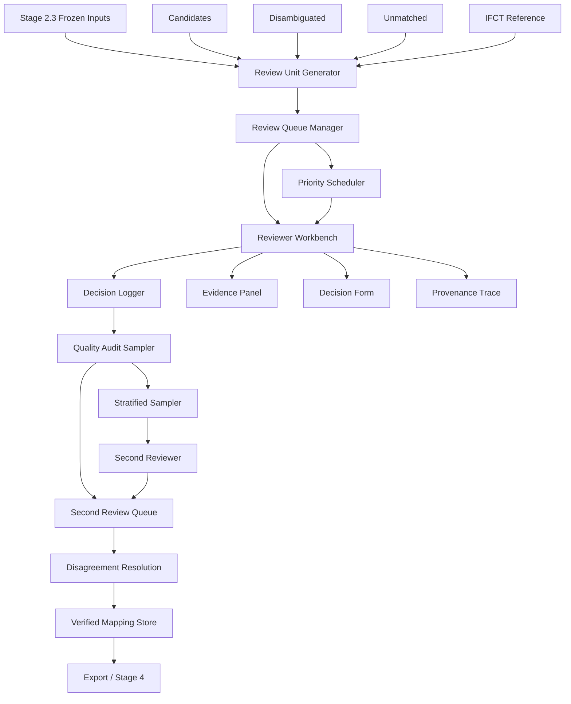

# Stage 3: Mapping Verification Architecture

## Overview

This document describes the architecture for manual verification of recipe ingredient → IFCT 2017 food code mappings produced in Stage 2.3.

**Input:** Stage 2.3 candidate outputs (frozen)
- `data/interim/phase3/stage2_3/ifct_match_candidates.parquet` — 119,474 candidate rows
- `data/interim/phase3/stage2_3/disambiguated_ingredients.parquet` — 90,862 disambiguated ingredient rows
- `data/interim/phase3/stage2_3/unmatched_ingredients.parquet` — 63,244 unmatched rows

**Output:** Verified mapping dataset with explicit decisions and full provenance.

---

## Core Design Principles

1. **Review at the mapping level** — Decide on unique (source ingredient, IFCT food code) pairs, not individual candidate rows.
2. **Evidence-based decisions** — Every decision must reference specific evidence fields.
3. **Preserve provenance** — Trace every accepted mapping back to original recipe lines.
4. **No forced mappings** — Reviewers can reject all candidates for an ingredient.
5. **Traceable rejections** — Every rejection has an explicit, recorded reason.
6. **No forced consensus** — If reviewers disagree, the mapping stays in REVIEW_REQUIRED.
7. **Traceability to source** — Every accepted mapping links back to all recipe occurrences.

---

## System Architecture



---

## Data Flow

### 1. Review Unit Generation (Offline, Deterministic)

**Input:** Stage 2.3 candidates (119,474 rows)

**Process:**
1. Group by `(primary_ingredient, ifct_food_code)`
2. Aggregate recipe IDs, candidate counts, method, prep state, max similarity
3. Attach disambiguation context (aliases, prep confidence, ambiguity flags)
4. Attach IFCT reference data (food name, group, nutrients)
5. Attach acceptance evidence from Stage 2.3
5. Compute priority score

**Output:** Review units (7,165 units)

| Field | Description |
|-------|-------------|
| `review_unit_id` | UUID |
| `primary_ingredient` | Cleaned ingredient name |
| `ifct_food_code` | IFCT code (e.g., G025) |
| `ifct_food_name` | Full IFCT food name |
| `ifct_food_group` | IFCT food group |
| `match_method` | EXACT / SYNONYM / TOKEN_EQUIVALENT / TOKEN_SIMILARITY |
| `recipe_count` | Number of recipes using this ingredient |
| `candidate_count` | Total candidate rows for this pair |
| `max_similarity` | Max similarity score across candidates |
| `preparation_state` | Detected prep state |
| `preparation_confidence` | Confidence of prep detection |
| `ambiguity_flags` | JSON array of flags |
| `extracted_aliases` | JSON array of aliases |
| `acceptance_evidence` | Stage 2.3 gate decision |
| `priority_score` | Numeric priority (see §5) |
| `status` | PENDING / ACCEPTED / REVIEW_REQUIRED / REJECTED / UNMATCHED / AMBIGUOUS |

### 2. Review Queue Management

**Queues:**
- `HIGH_PRIORITY` — EXACT + FRESH/RAW, verified SYNONYM
- `MEDIUM_PRIORITY` — High-similarity TOKEN_EQUIVALENT, verified SYNONYM
- `STANDARD_PRIORITY` — TOKEN_EQUIVALENT, high-similarity TOKEN_SIMILARITY
- `LOW_PRIORITY` — Remaining TOKEN_SIMILARITY
- `SPECIAL` — Multi-code ambiguity, unmatched ingredients

**Scheduler:**
- Pull from highest non-empty queue
- Batch size: 50 units per reviewer session
- Lock unit on assignment (TTL: 4 hours)

### 3. Reviewer Workbench (Interactive)

**Evidence Panel (Read-only):**
- Source ingredient (original, normalized, primary)
- Parenthetical text & extracted aliases
- Preparation state & confidence
- IFCT food name, group, full nutrient profile
- All candidate ranks for this ingredient
- Recipe context (sample of 5 recipe lines)
- Stage 2.3 acceptance evidence
- Multi-code ambiguity warning

**Decision Form:**
- Status dropdown: ACCEPTED / REVIEW_REQUIRED / REJECTED / UNMATCHED / AMBIGUOUS
- Required: Rationale (free text, min 50 chars)
- Optional: Alternative IFCT code
- Required: Confidence (1-5 scale)
- Timestamp & reviewer ID auto-captured

**Provenance Trace (Read-only):**
- All recipe IDs & original lines for this ingredient
- Source field (ingredients_raw / ingredients_en)
- Disambiguation lineage

### 4. Decision Logging

**Decision Record:**
```json
{
  "review_unit_id": "uuid",
  "reviewer_id": "string",
  "timestamp": "ISO8601",
  "status": "ACCEPTED|REVIEW_REQUIRED|REJECTED|UNMATCHED|AMBIGUOUS",
  "rationale": "string (min 50 chars)",
  "confidence": 1-5,
  "alternative_ifct_code": "string|null",
  "evidence_references": ["field1", "field2", ...],
  "session_id": "uuid",
  "duration_seconds": int
}
```

### 5. Quality Audit Pipeline

**Stratified Sampling:**
- 20% of ACCEPTED (stratified by match_method, prep_state)
- 10% of REVIEW_REQUIRED
- 5% of REJECTED
- All AMBIGUOUS and UNMATCHED

**Second Review:**
- Independent reviewer
- Blind to first decision (except rationale)
- Same evidence panel

**Disagreement Resolution:**
- If status differs → CONFLICT
- Auto-escalate to senior reviewer
- Resolution recorded with rationale

---

## Storage Schema

### Review Units Table
```sql
CREATE TABLE review_units (
  review_unit_id UUID PRIMARY KEY,
  primary_ingredient TEXT NOT NULL,
  ifct_food_code TEXT NOT NULL,
  ifct_food_name TEXT NOT NULL,
  ifct_food_group TEXT NOT NULL,
  match_method TEXT NOT NULL,
  recipe_count INT NOT NULL,
  candidate_count INT NOT NULL,
  max_similarity FLOAT NOT NULL,
  preparation_state TEXT NOT NULL,
  preparation_confidence FLOAT,
  ambiguity_flags JSONB,
  extracted_aliases JSONB,
  acceptance_evidence JSONB,
  priority_score FLOAT NOT NULL,
  status TEXT NOT NULL DEFAULT 'PENDING',
  created_at TIMESTAMP DEFAULT NOW(),
  updated_at TIMESTAMP DEFAULT NOW()
);
```

### Decisions Table
```sql
CREATE TABLE decisions (
  decision_id UUID PRIMARY KEY,
  review_unit_id UUID REFERENCES review_units(review_unit_id),
  reviewer_id TEXT NOT NULL,
  timestamp TIMESTAMP NOT NULL,
  status TEXT NOT NULL,
  rationale TEXT NOT NULL,
  confidence SMALLINT CHECK (confidence BETWEEN 1 AND 5),
  alternative_ifct_code TEXT,
  evidence_references JSONB,
  session_id UUID NOT NULL,
  duration_seconds INT,
  created_at TIMESTAMP DEFAULT NOW()
);
```

### Audit Samples Table
```sql
CREATE TABLE audit_samples (
  sample_id UUID PRIMARY KEY,
  review_unit_id UUID REFERENCES review_units(review_unit_id),
  first_decision_id UUID REFERENCES decisions(decision_id),
  second_reviewer_id TEXT,
  second_decision_id UUID REFERENCES decisions(decision_id),
  agreement BOOLEAN,
  escalated BOOLEAN DEFAULT FALSE,
  resolved_by TEXT,
  resolution_timestamp TIMESTAMP,
  created_at TIMESTAMP DEFAULT NOW()
);
```

### Provenance Links Table
```sql
CREATE TABLE provenance_links (
  review_unit_id UUID REFERENCES review_units(review_unit_id),
  recipe_id INT NOT NULL,
  original_line TEXT NOT NULL,
  source_field TEXT NOT NULL,
  PRIMARY KEY (review_unit_id, recipe_id)
);
```

---

## Interface Contracts

### Review Unit Generator (Offline)
```python
def generate_review_units(
    candidates_path: Path,
    disambiguated_path: Path,
    ifct_path: Path,
    output_path: Path
) -> List[ReviewUnit]:
    """Pure function. Deterministic. No side effects."""
```

### Review Queue Manager
```python
class ReviewQueueManager:
    def get_next_batch(self, reviewer_id: str, batch_size: int = 50) -> List[ReviewUnit]
    def lock_unit(self, unit_id: UUID, reviewer_id: str, ttl_hours: int = 4) -> bool
    def release_lock(self, unit_id: UUID, reviewer_id: str) -> bool
    def get_queue_stats(self) -> Dict[str, int]
```

### Reviewer Workbench API
```python
class ReviewerWorkbench:
    def get_evidence_panel(self, unit_id: UUID) -> EvidencePanel
    def submit_decision(self, unit_id: UUID, decision: Decision) -> DecisionRecord
    def get_unit_history(self, unit_id: UUID) -> List[DecisionRecord]
```

---

## Non-Functional Requirements

| Requirement | Target |
|-------------|--------|
| Deterministic review unit generation | ✅ |
| Reviewer session isolation | Lock TTL 4h |
| Decision immutability | Append-only log |
| Audit trail completeness | 100% traceability |
| Reviewer anonymity | ID only, no PII |
| Concurrent reviewers | Unlimited (row-level locks) |
| Offline review unit generation | < 30 seconds |
| Interactive response time | < 500ms |

---

## Unresolved Design Decisions

| Decision | Options | Recommendation |
|----------|---------|----------------|
| Reviewer authentication | Internal ID / SSO / Anonymous tokens | Internal ID (simple, auditable) |
| Conflict resolution authority | Senior reviewer / Committee / Automated tie-break | Senior reviewer |
| Web vs Desktop UI | Browser-based / Electron / CLI | Browser (accessible) |
| Real-time collaboration | None / Comments / Live cursor | Comments only |
| Export format | Parquet / CSV / JSON / SQLite | Parquet + CSV |
| Long-term storage | Local filesystem / S3 / Database | Local Parquet + SQLite |

---

## Acceptance Criteria for Architecture

- [ ] Review units cover 100% of Stage 2.3 candidate pairs (7,165 units)
- [ ] Priority ordering matches §5 specification
- [ ] Provenance traceable to original recipe lines
- [ ] Decision log append-only, tamper-evident
- [ ] Audit sampling reproducible with fixed seed
- [ ] All schemas versioned and documented
- [ ] No Stage 2.3 files modified
- [ ] All design docs in `reports/phase3/`